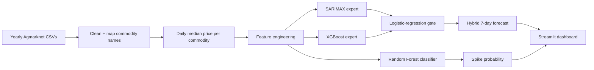

# Price-prediction-for-vegetable-and-pulses

### Volatility-Gated Hybrid Forecasting (VG-HF): SARIMA + XGBoost

7-day-ahead price forecasting and price-spike alerts for **3 vegetables and 4 pulses**, built on Agmarknet daily mandi prices (2018–2026).


---

## Table of Contents

1. [Overview](#overview)
2. [Highlights](#highlights)
3. [Pipeline](#pipeline)
4. [Dataset](#dataset)
5. [Feature Engineering](#feature-engineering)
6. [Models](#models)
7. [Evaluation Protocol](#evaluation-protocol)
8. [Results](#results)
9. [Dashboard](#dashboard)
10. [Repository Structure](#repository-structure)
11. [Installation](#installation)
12. [Usage](#usage)
13. [Limitations](#limitations)
14. [Future Work](#future-work)
15. [Author](#author)
16. [License](#license)

---

## Overview

Prices of vegetables and pulses in Indian mandis swing sharply, which is a problem for farmers, traders and policymakers. This project forecasts the **modal price 7 days ahead** for 7 commodities and estimates the **probability of a 15%+ price spike** within the same window.

Two forecasters with different strengths are combined:

- **SARIMAX** captures trend and yearly seasonality.
- **XGBoost** captures non-linear effects of momentum and volatility.

A **logistic-regression gate** learns how much to trust each, using recent volatility and the month of the year.

**Commodities:** Tomato, Onion, Potato (vegetables) · Tur, Moong, Urad, Chana (pulses)

## Highlights

- End-to-end pipeline: raw CSVs → cleaning → features → models → statistical evaluation → dashboard
- Strictly **time-ordered** validation with no random shuffling and no look-ahead leakage
- Compared against **Naive, SARIMA, XGBoost, Random Forest and a 50/50 blend**
- Significance testing with the **Diebold-Mariano test** and a **moving-block bootstrap CI**
- **Rolling-origin** validation over 4 windows to check stability
- Spike detector benchmarked against trivial and rule-based baselines
- Results are reported honestly, including where the hybrid does **not** win

## Pipeline



## Dataset

| Item | Detail |
|---|---|
| Source | Agmarknet daily mandi prices (one CSV per year, 2018–2026) |
| Columns used | state, market, commodity, date, modal price |
| Target | Modal price in Rs/quintal |
| Granularity | Daily median across all reporting markets (all-India) |
| Size | ~1M rows per year, 3,032 daily observations per commodity |

> The raw CSVs are **not included** in this repository. Download them from Agmarknet and place them in a folder (see [Usage](#usage)).

**Preprocessing**

1. **Commodity mapping.** Raw names are mapped to 7 canonical names using include/exclude regexes. For example, Tur matches "arhar" but excludes "dal", "flour" and "powder" so processed products aren't mixed in.
2. **Date parsing.** The format is auto-detected (YMD, DMY or MDY), with a warning when ambiguous.
3. **Outlier removal.** Prices outside 1/5× to 5× of the commodity's yearly median are dropped as entry errors.
4. **Daily aggregation.** The median across markets is taken per commodity per day.
5. **Gap handling.** Missing days (~1%) are linearly interpolated. An `obs` flag marks real observations, and only rows where both the forecast origin and the target day are real are used for training and evaluation.
6. **Commodity filter.** Commodities with fewer than 300 observed days are skipped.

**Price volatility** (std of 7-day log change):

| Commodity | Group | Volatility |
|---|---|---|
| Tomato | Vegetable | 0.123 |
| Urad | Pulse | 0.090 |
| Onion | Vegetable | 0.088 |
| Potato | Vegetable | 0.072 |
| Chana | Pulse | 0.068 |
| Moong | Pulse | 0.054 |
| Tur | Pulse | 0.044 |

## Feature Engineering

All features use only information available on the forecast date.

| Feature | Description |
|---|---|
| `ret_1`, `ret_7`, `ret_14`, `ret_28` | Past log price changes (momentum) |
| `vol_7`, `vol_14`, `vol_30` | Rolling std of daily log returns |
| `vol_ratio` | `vol_7 / vol_30`, short vs long volatility regime |
| `ma7_gap`, `ma30_gap` | Log price minus its 7 and 30-day moving average |
| `month_sin`, `month_cos` | Cyclical month encoding for seasonality |
| `is_pulse` | 1 for pulses, 0 for vegetables |

**Targets**

- `y_ret`: 7-day-ahead log return (XGBoost and RF regression target)
- `y_price`: price 7 days ahead (used for evaluation)
- `fut_max_rise`: max rise over the next 7 days (spike label: ≥ 15%)

## Models

| Component | Algorithm | Role |
|---|---|---|
| Expert 1 | **SARIMAX(1,1,1)** on log price with 2 Fourier seasonal terms | Trend and yearly seasonality |
| Expert 2 | **XGBoost Regressor** (300 trees, depth 3, lr 0.03) on 7-day log return | Non-linear, feature-driven forecast |
| Gate | **Logistic Regression** on `vol_14`, `vol_30`, `month_sin`, `month_cos` | Outputs w = P(XGBoost is closer to truth) |
| Hybrid | `w · XGBoost + (1 − w) · SARIMA` | Final forecast (VG-HF) |
| Comparison | **Random Forest Regressor** (300 trees, depth 8) | Alternative ML baseline |
| Spike detector | **Random Forest Classifier** (balanced class weights) | P(price rises ≥ 15% within 7 days) |

**How the gate is trained.** XGBoost is trained on the early training segment only. Both experts then forecast a later, unseen gate-training segment, and each row is labelled 1 if XGBoost was closer to the actual price than SARIMA. The gate is fit on those labels, so it never sees forecasts the experts made on their own training data.

## Evaluation Protocol

| Segment | Period |
|---|---|
| Expert training | up to 2023-02-10 |
| Gate training | 2023-02-11 → 2025-04-20 |
| **Test** | **2025-04-21 → 2026-04-20** (last 365 days) |

- Splits are chronological, with no shuffling.
- Training targets must be known before the cutoff (`train_end − H`).
- Forecast dates are sampled every 3rd day to reduce overlap between 7-day horizons.
- **Metrics:** MAE, RMSE, MAPE for regression. Precision, recall, F1, ROC-AUC and PR-AUC for spikes.
- **Significance:** Diebold-Mariano (Newey-West, per commodity) and a moving-block bootstrap 95% CI (pooled).
- **Robustness:** rolling-origin evaluation over 4 windows of ~91 days, plus a volatility-regime split.

## Results

### 7-day-ahead forecast accuracy (test year, mean across commodities)

| Model | MAE | RMSE | MAPE (%) |
|---|---|---|---|
| Naive (price unchanged) | 223.81 | 417.37 | 7.13 |
| SARIMA | 230.65 | 386.39 | 7.10 |
| XGBoost | 220.74 | 407.06 | 7.00 |
| Random Forest | 219.18 | 399.65 | 6.99 |
| 50/50 blend | 220.34 | 388.62 | **6.89** |
| Gated hybrid (VG-HF) | 219.32 | 391.33 | 6.90 |

### MAPE (%) per commodity

| Model | Chana | Moong | Onion | Potato | Tomato | Tur | Urad |
|---|---|---|---|---|---|---|---|
| Naive | 7.52 | 5.20 | 9.01 | 8.30 | 9.55 | 4.29 | 6.01 |
| SARIMA | 8.37 | 5.53 | 9.05 | 7.94 | 8.46 | 4.57 | 5.75 |
| XGBoost | 7.55 | 5.38 | 9.19 | 8.91 | 8.44 | 4.31 | 5.26 |
| Random Forest | 7.39 | 5.30 | 8.96 | 8.96 | 8.63 | 4.22 | 5.44 |
| 50/50 blend | 7.84 | 5.28 | 9.04 | 8.19 | 8.28 | 4.33 | 5.29 |
| Gated hybrid | 7.71 | 5.26 | 9.08 | 8.37 | 8.29 | 4.30 | 5.27 |

### Statistical significance (pooled block bootstrap, 95% CI)

| Comparison | Mean diff (MAPE pts) | 95% CI | Significant |
|---|---|---|---|
| Hybrid vs Naive | −0.661 | [−1.162, −0.201] | Yes |
| Hybrid vs 50/50 blend | +0.064 | [−0.084, 0.230] | No |
| Hybrid vs SARIMA | −0.012 | [−0.561, 0.622] | No |
| Hybrid vs XGBoost | −0.258 | [−0.600, 0.026] | No |

Per commodity (Diebold-Mariano, p < 0.05), the hybrid significantly beats Naive only on **Tomato** (p = 0.039) and SARIMA only on **Chana** (p = 0.019).

### Gate vs fixed weights vs oracle

| Strategy | MAPE (%) |
|---|---|
| Naive | 7.148 |
| SARIMA | 7.114 |
| XGBoost | 7.022 |
| Fixed 50/50 | 6.912 |
| Fixed tuned (w_xgb = 0.80) | 6.946 |
| **Gated hybrid (VG-HF)** | 6.915 |
| Oracle (always picks the better expert, upper bound) | 5.754 |

### Error by volatility regime (MAPE %)

| Model | High volatility | Low volatility |
|---|---|---|
| Naive | 8.58 | 5.70 |
| SARIMA | 8.44 | 5.78 |
| XGBoost | 8.38 | 5.66 |
| Fixed 50/50 | 8.23 | 5.58 |
| Gated hybrid | 8.24 | 5.58 |

### Spike detection (≥ 15% rise within 7 days; 19.9% of test days)

| Model | Precision | Recall | F1 | ROC-AUC | PR-AUC |
|---|---|---|---|---|---|
| **Random Forest** | 0.400 | 0.594 | **0.478** | **0.758** | **0.456** |
| Logistic Regression | 0.330 | 0.712 | 0.451 | 0.726 | 0.390 |
| Rule: `ret_7 ≥ 0.076` | 0.187 | 0.123 | 0.148 | 0.416 | 0.176 |
| Always predict spike | 0.199 | 1.000 | 0.332 | 0.500 | 0.199 |
| Never predict spike | 0.000 | 0.000 | 0.000 | 0.500 | 0.199 |

### Key findings

1. **All models are close.** The best and worst differ by about 0.25 MAPE points.
2. **The hybrid beats Naive significantly** in the pooled test, but is statistically indistinguishable from SARIMA, XGBoost and a plain 50/50 blend.
3. **The learned gate is weak.** Its coefficients are close to zero, so it behaves almost like a fixed blend (6.915 vs 6.912 for 50/50).
4. **There is headroom in switching.** An oracle that always picks the better expert reaches 5.75% MAPE, so a better gate could help.
5. **Errors are larger in high-volatility periods** (~8.2%) than in low-volatility ones (~5.6%).
6. **Spike detection is the stronger result.** The Random Forest reaches F1 0.48 and ROC-AUC 0.76, well above trivial baselines.
7. **Momentum alone is a poor spike predictor.** The `ret_7` rule has ROC-AUC 0.416, below chance, which suggests mean reversion after recent rises.

## Dashboard

An interactive **Streamlit** app (`app.py`) with three tabs:

- **Forecast:** latest price, 7-day hybrid forecast with a Rise / Fall / Stable signal (±2% threshold), gate weight, spike-risk gauge (Low < 25%, Moderate < 50%, High ≥ 50%), price history chart with forecast points, and a model comparison table.
- **Model performance:** overall metrics, spike metrics and evaluation figures.
- **About:** data, models and limitations.

At forecast time the app recomputes features from the latest observation, refits SARIMAX, and blends it with the saved XGBoost model using the gate weight.

## Repository Structure

```
├── DSE_price_prediction.ipynb   # Full pipeline (data → models → evaluation → app)
├── app.py                       # Streamlit dashboard (generated by the notebook)
├── requirements.txt
├── artifacts/
│   ├── bundle.joblib            # Trained XGBoost, gate, RF, feature list, settings
│   └── panel.csv                # Cleaned daily price panel
├── results/
│   ├── metrics_overall.csv
│   ├── metrics_by_commodity.csv
│   ├── significance_bootstrap.csv
│   ├── significance_dm_by_commodity.csv
│   ├── gate_vs_oracle.csv
│   ├── mape_by_regime.csv
│   ├── rolling_origin_mape.csv
│   ├── spike_baselines.csv
│   └── spike_metrics.json
└── figures/
    ├── price_history.png
    ├── forecast_vs_actual.png
    ├── model_comparison.png
    ├── feature_importance.png
    ├── gate_weights.png
    ├── regime_mape.png
    ├── spike_baselines.png
    └── rolling_origin.png
```

## Installation

```bash
git clone <your-repo-url>
cd <your-repo>
python -m venv venv
source venv/bin/activate        # Windows: venv\Scripts\activate
pip install -r requirements.txt
```

`requirements.txt`

```
numpy
pandas
matplotlib
scipy
scikit-learn
statsmodels
xgboost
joblib
altair
streamlit
```

## Usage

### 1. Train and evaluate

The notebook was built for **Google Colab**.

1. Upload the yearly Agmarknet CSVs (`2018.csv` … `2026.csv`) to a Drive folder.
2. Open `DSE_price_prediction.ipynb` in Colab.
3. Set the data path in the data-loading cell:
   ```python
   DATA_DIR = "/content/drive/MyDrive/csv"
   START_YEAR, END_YEAR = 2018, 2026
   STATE_REGEX = None        # None = all-India; use "tamil" for Tamil Nadu only
   ```
4. Run all cells. This produces `artifacts/`, `results/`, `figures/` and `app.py`.

### 2. Run the dashboard locally

```bash
streamlit run app.py
```

### 3. Run the dashboard from Colab

The last notebook cell starts Streamlit and exposes it through a temporary Cloudflare tunnel, then prints a public `trycloudflare.com` link.

### Key settings

| Setting | Value | Meaning |
|---|---|---|
| `H` | 7 | Forecast horizon (days) |
| `TEST_DAYS` | 365 | Held-out test period |
| `GATE_FRAC` | 0.30 | Share of training period used to train the gate |
| `SPIKE_THR` | 0.15 | Rise of 15% or more counts as a spike |
| `MIN_OBS` | 300 | Minimum real observed days per commodity |

## Limitations

- **No arrivals or rainfall** data, which are important drivers of mandi prices.
- **Small gains over simple baselines.** The hybrid is statistically indistinguishable from a plain 50/50 blend.
- **Weak gate.** It uses only volatility and month features and learns near-zero weights.
- **All-India median prices.** Forecasts are not market-specific.
- **Interpolated gaps** (~1% of days) were used for feature computation.
- **Overlapping 7-day horizons** make forecast errors autocorrelated, so significance tests may be slightly optimistic.
- **The spike alert is experimental,** with moderate precision (0.40).

## Future Work

- Add arrivals, rainfall, fuel price and MSP features
- Improve the gate with richer inputs such as `vol_ratio`, `ret_7` and the experts' recent errors
- Market-level and state-level models
- Multi-horizon forecasts (1, 7, 14, 30 days) and prediction intervals
- Add LSTM or Temporal Fusion Transformer baselines
- Calibrate spike probabilities and tune the decision threshold

## Author

**Niwisha,Dalina** 
B.Tech Computer Science and Engineering, Karunya Institute of Technology and Sciences

## License

Released under the MIT License. See `LICENSE` for details.

## Disclaimer

This is a research prototype and **not financial advice**. Forecasts can be wrong.
